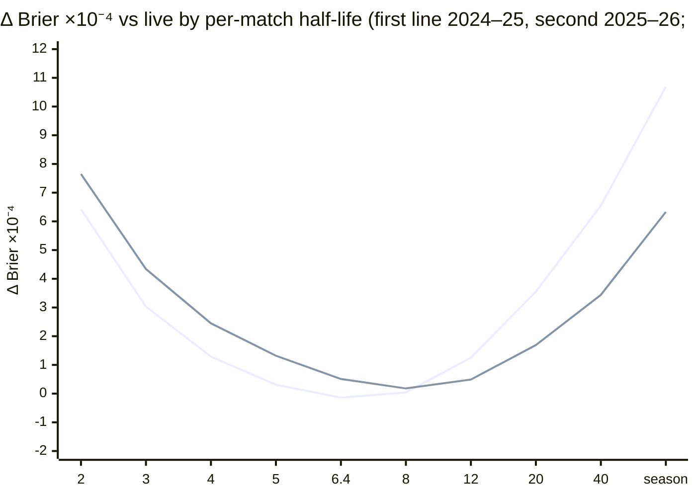

# R4: recency and decay (measured; no change)

**Verdict: no build.** The live engine (3.3.0) already sits at the sweet spot of the decay curve. Its gain floor (`kMin` 0.33) works like a per-match half-life of 6.4 matches, and the curve's minimum is at 6.4–8 matches on both seasons. No decay variant passes the gate, whether fixed or chosen by rolling origins. The two endpoints are clearly worse: "whole season" costs +10.7 / +6.3 ×10⁻⁴ Brier and "last event only" costs +13.8 / +12.4 ×10⁻⁴.
- Script: `scripts/research/r4-recency.ts` (shared harness: `scripts/research/lib.ts`).
- Output: `r4-recency-2026-11-03.json`, with every variant, season, slice and rolled month.

## Research note: time-weighted ratings, form against class

- **Exponential time weighting.** Dixon & Coles (1997, *Applied Statistics*) weight each past match by exp(−ξ·age) in the likelihood. They pick ξ by out-of-sample predictive performance, not in-sample fit. The method here is the same: a family of decay rates, judged walk-forward.
- **Constant gain is exponential forgetting.** Muth (1960, *JASA*) showed that exponential smoothing is the optimal forecast when the true level follows a random walk observed with noise. At steady state the Kalman gain is a constant, and a constant gain is a fixed per-observation half-life. So an Elo or EPA rating with a gain floor already down-weights old matches exponentially. The open question is only how fast.
- **Time-based uncertainty.** Glicko (Glickman 1999, *Applied Statistics*) does not discount the rating itself. It widens the rating deviation with time away (c² per period), so the next results move the rating more. This is a per-week decay of evidence, not of level.
- **Between-season regression.** FiveThirtyEight-style Elo pulls ratings part of the way back to the mean between seasons. This is the coarsest possible decay.
- **Form against class.** In football, Hvattum & Arntzen (2010, *IJF*) found that a well-tuned rating beats covariates built from recent results ("form"). Recent results are mostly noise around a stable level. The usual finding is that form helps only as a small, quickly fading correction on top of class, which is the shape of the engine's 2.9 event-local form.

## What the engine already does (and where)

| Mechanism | Where | What it is in decay terms |
|---|---|---|
| Gain `max(kMin, k0 / (1 + n/n0))` | `rating.ts` `fold` | Up to about 10 matches, the gain falls like 1/n: roughly every match this season counts the same ("whole season"). After that the floor holds the gain at 0.33: **exponential per-match forgetting**. The steady-state evidence is W* = n0·(k0/kMin − 1) = 9.70 matches, i.e. a half-life of ln ½ / ln(1 − 1/W*) = **6.37 matches**. Part 12.4 swept `kMin` and found it at its peak (±0.05 costs +0.6 to +0.8 ×10⁻⁴). |
| Season carry-over ρ1 0.7, ρ2 0.2 | `priorZ` | Between-season decay of last season's z (Part 8, 2.7). |
| Season growth | `growth()` | Raises the level with weeks since the last match. It is a drift term, not a weighting. |
| Rebuild handling (`rebuildGapWeeks`, `rebuildN`) | `fold`, `breakWeeks` | A gain bump after a break, which is a step-shaped per-week decay. It is off. 2.1 rejected it and it was re-tested and rejected again on 3.2 (`part12/rebuild-gain.md`). |
| Event-local form (2.9) | `eventOffset` | "Form" on top of "class": λ × the mean miss at the current event × κ/(n+κ), gone at the next event. |

This test therefore asks two things. Does a different forgetting curve beat the floor's 6.4-match half-life? Does a continuous per-week decay beat the rejected step (rebuild)?

## Method

**Patched books.** Every variant is the live engine, unchanged except for the update gain:
- event form, regional priors, carry-over, overlap, the contextual model and its recalibration are all live;
- the engine already reads the gain experience `gainN ?? n`, so the script sets `gainN` to a discounted evidence count W just before each update;
- `packages/predict-engine` is not edited.

**The variants:**
- **per match, kMin 0:** W ← W·2^(−1/h) + 1 after each match, with h ∈ {2, 3, 4, 5, 6.4, 8, 12, 20, 40}. Here the decay alone sets the floor.
- **whole season (endpoint):** no decay and kMin 0, so the gain is about 1/n all season.
- **per week:** W ← W·2^(−weeks since the team's last match / h) at each update, with h ∈ {0.5, 1, 2, 4, 8, 16} weeks. Run twice: with the live floor, and with kMin 0 (pure time weighting).
- **last event only (endpoint):** W back to 0 at a team's first match of each new event. Run with the live floor and with kMin 0.
- **context only:** live without event form (`eventLambda*` 0), to show what the form layer is worth.

**Protocol (identical for every model):**
- Walk-forward replay of the backtest corpus (`scripts/slices/corpus.ts`): 2023–24 as warm-up (cold start), then 2024–25 (tuning) and 2025–26 (**reused**).
- The served call (`predictMatch` + contextual model), pre-match only, at rated events, on 2-robot alliances.
- **Decisive matches only**: ties are left out of every metric. That gives 33,017 matches for 2024–25 and 36,572 for 2025–26.
- Metrics: Brier (primary), winner accuracy, and margin MAE (|expected red − blue margin − actual margin|, points).
- Δ = variant − live, on identical matches, with 95% intervals from 2,000 bootstraps over whole events.

**Rolling origins** (Part 9 / 12.5): for each month from October 2024 to July 2026, pick the family member with the lowest Brier over the previous 365 days and use its calls for that month.

**Gate:**
- Δ Brier's interval lies below zero;
- neither accuracy's nor margin MAE's interval lies entirely on the worse side;
- both of the above hold on both seasons.

**Reproduction check:**
- With ties counted as 0.5, this replay's champion scores Brier 0.16723 on 2025–26, which is the stored 3.3.0 slice report exactly.
- Engine 1.x reproduces 72.66% / 0.1791. That is the prompt's "72.7% / 0.179": a pre-2.0 baseline, reported here for context only.

Live 3.3.0 on decisive matches:

| Season | Brier | Accuracy | Margin MAE |
|---|---|---|---|
| 2024–25 | 0.1578 | 76.54% | 38.85 |
| 2025–26 | 0.1681 | 74.79% | 37.48 |

## The decay curve

Brier change against live, ×10⁻⁴ (negative is better), per-match family (kMin 0):

| Per-match half-life | 2024–25 Δ Brier [95%] | quals 1–10 | 0–5 matches | Δ acc pp | Δ margin MAE | 2025–26 Δ Brier [95%] | quals 1–10 | 0–5 matches | Δ acc pp | Δ margin MAE |
|---|---|---|---|---|---|---|---|---|---|---|
| 2 | +6.42 [+2.99, +9.98] | +8.33 | +4.25 | −0.21 | −0.011 | +7.65 [+4.48, +10.42] | +7.34 | +4.13 | −0.30 | +0.172 |
| 3 | +3.03 [+0.46, +5.70] | +4.71 | +2.45 | −0.11 | −0.064 | +4.34 [+2.02, +6.45] | +4.76 | +2.62 | −0.19 | +0.087 |
| 4 | +1.29 [−0.69, +3.32] | +2.67 | +1.40 | −0.05 | −0.079 | +2.45 [+0.72, +4.05] | +3.19 | +1.72 | −0.09 | +0.038 |
| 5 | +0.31 [−1.25, +1.85] | +1.26 | +0.55 | −0.04 | −0.074 | +1.32 [+0.06, +2.50] | +2.00 | +1.15 | −0.04 | +0.013 |
| **6.4** (≈ live floor) | **−0.14 [−1.24, +0.94]** | +0.02 | −0.15 | +0.02 | −0.050 | +0.51 [−0.30, +1.31] | +1.07 | +0.55 | −0.01 | +0.002 |
| **8** | +0.04 [−0.90, +0.91] | −0.78 | −0.55 | −0.02 | −0.013 | **+0.18 [−0.52, +0.90]** | +0.33 | +0.15 | −0.01 | +0.004 |
| 12 | +1.25 [+0.00, +2.44] | −1.49 | −0.97 | −0.05 | +0.080 | +0.49 [−0.63, +1.67] | −0.18 | −0.17 | −0.03 | +0.030 |
| 20 | +3.55 [+1.46, +5.54] | −1.81 | −1.05 | −0.13 | +0.211 | +1.69 [−0.15, +3.59] | −0.51 | −0.41 | −0.02 | +0.083 |
| 40 | +6.55 [+3.65, +9.46] | −1.60 | −0.89 | −0.19 | +0.370 | +3.44 [+0.91, +6.05] | −0.51 | −0.49 | −0.08 | +0.158 |
| ∞: **whole season** | +10.69 [+6.77, +14.68] | −1.08 | −0.39 | −0.28 | +0.588 | +6.33 [+2.99, +9.84] | −0.03 | −0.41 | −0.12 | +0.275 |

**Sweet spot: a per-match half-life of 6.4–8 matches** in both seasons, which is where the live floor already is (6.37). Read across the columns, the curve shows the form-against-class trade-off:
- **Short half-lives** (2–5) chase noise. They are worst early in events (quals 1–10 +2 to +8) and cost accuracy.
- **Long half-lives** (12 up to whole season) help the first matches a little (quals 1–10 and 0–5 matches −0.4 to −1.8, because a new robot's early results are not forgotten), but they go stale later in the season. Overall Brier, accuracy and margin MAE all get worse.

**Per week, and the endpoints** (Δ Brier ×10⁻⁴ [95%]):

| Variant | 2024–25 | 2025–26 |
|---|---|---|
| Per-week half-life 0.5 / 1 / 2 weeks, live floor | +11.68 / +8.11 / +3.24 [−0.17, +6.61] | +10.93 / +8.16 / +3.85 [+1.03, +6.60] |
| Per-week half-life 4 weeks, live floor | +0.08 [−2.01, +2.14] | +0.58 [−1.10, +2.18] |
| Per-week half-life 8 weeks, live floor | −0.52 [−1.64, +0.54] (acc +0.02, MAE −0.070) | −0.14 [−0.86, +0.62] (acc −0.03, MAE −0.020) |
| Per-week half-life 16 weeks, live floor | −0.19 [−0.66, +0.27] | +0.12 [−0.23, +0.46] |
| Per-week half-life 4 / 8 / 16 weeks, kMin 0 | +0.54 / +1.36 / +4.26 | +1.06 / +0.39 / +1.87 |
| **Last event only**, live floor | +13.75 [+9.02, +18.86] | +12.38 [+8.06, +16.42] |
| **Last event only**, kMin 0 | +13.76 [+9.02, +18.87] | +12.41 [+8.07, +16.44] |
| Live **without event form** (context) | +2.17 [+1.20, +3.18]; quals 1–10 +2.54, 0–5 matches +3.09 | +2.49 [+1.65, +3.43]; quals 1–10 +3.76, 0–5 matches +3.64 |

- **Per-week decay on top of the live floor is neutral at 8–16 weeks and harmful below 4.** It is a smooth version of the rebuild bump. Like that bump (`part12/rebuild-gain.md`), it finds nothing beyond noise.
- **"Last event only" is the worst variant tested.** Throwing away earlier events costs more than any half-life does.
- **Event form, the engine's "form" layer, is worth 2.2–2.5 ×10⁻⁴** overall and 2.5–3.8 on the weakest slices. Form adds to class as a fading correction; replacing class with recent form loses.

## Rolling origins and the gate

Each family's member was re-chosen every month on the 365 days before it. Challenger minus live:

| Family | 2024–25 Δ Brier [95%] | Δ acc pp [95%] | Δ MAE [95%] | 2025–26 Δ Brier [95%] | Δ acc pp [95%] | Δ MAE [95%] | Monthly picks | Gate |
|---|---|---|---|---|---|---|---|---|
| Per-match (kMin 0) | +0.97 [−0.09, +1.97] | −0.06 [−0.16, +0.04] | +0.039 [+0.012, +0.065] | +0.38 [−0.47, +1.25] | −0.02 [−0.11, +0.08] | +0.000 [−0.017, +0.017] | 12 → 6.4 → 8 | fail |
| Per-week, live floor | −0.17 [−1.03, +0.69] | −0.02 [−0.10, +0.06] | −0.045 [−0.070, −0.022] | +0.00 [−0.66, +0.69] | −0.04 [−0.12, +0.04] | −0.013 [−0.025, −0.001] | 16 → 8 weeks, live from Mar 2026 | fail |
| Per-week (kMin 0) | +1.42 [−0.45, +3.31] | −0.04 [−0.17, +0.09] | −0.017 [−0.072, +0.035] | +0.23 [−1.40, +1.92] | −0.05 [−0.18, +0.08] | −0.029 [−0.063, +0.007] | 8 → 4 → 8 weeks | fail |
| All recency variants + live | +0.68 [−0.90, +2.22] | −0.05 [−0.18, +0.08] | −0.018 [−0.060, +0.023] | +0.00 [−0.66, +0.69] | −0.04 [−0.12, +0.04] | −0.013 [−0.025, −0.001] | per-week kMin 0 → per-week floor 8 → live | fail |

The fixed picks, the best member of each family on 2024–25 judged on both seasons, fail too:
- per match, 6.4: −0.14 [−1.24, +0.94] and +0.51 [−0.30, +1.31];
- per week with the floor, 8 weeks: −0.52 [−1.64, +0.54] and −0.14 [−0.86, +0.62].

Weakest slices under the rolled per-week/floor family:
- quals 1–10: −0.74 [−1.67, +0.16] and −0.07 [−1.12, +0.97];
- 0–5 matches: −0.51 [−1.36, +0.32] and +0.18 [−0.56, +0.96].

The one consistent signal is a slightly lower margin MAE with an 8-week per-week decay on the floor: −0.045 and −0.013 points rolled, both beyond noise. It is a few hundredths of a point, and Brier does not move, so it is recorded, not built.

## Answer to the brief

- **How fast should old matches stop counting?** With a half-life of about 6–8 matches. That is what the live gain floor already does.
- **Last event against whole season:** neither. A whole-season (equal-weight) rating is +6 to +11 ×10⁻⁴ worse, and a last-event-only rating +12 to +14 worse.
- **Does any decay beat the current gain schedule plus event form?** No. The best variants are ties within ±0.5 ×10⁻⁴, and all fail the gate.

## Caveats

- 2025–26 is reused data. 2023–24 is a cold start in this snapshot, so the first rolled months' windows are mostly a season with no carry-over.
- Rolling selection switches between fixed-setting replays. A live engine that changed its half-life mid-season would carry a slightly different rating state. With picks this stable (two or three switches in 22 months) the difference is small.
- Per-match decay counts playoff matches like quals. Playoff updates already carry `playoffWeight` 0.5 in the gain itself.
